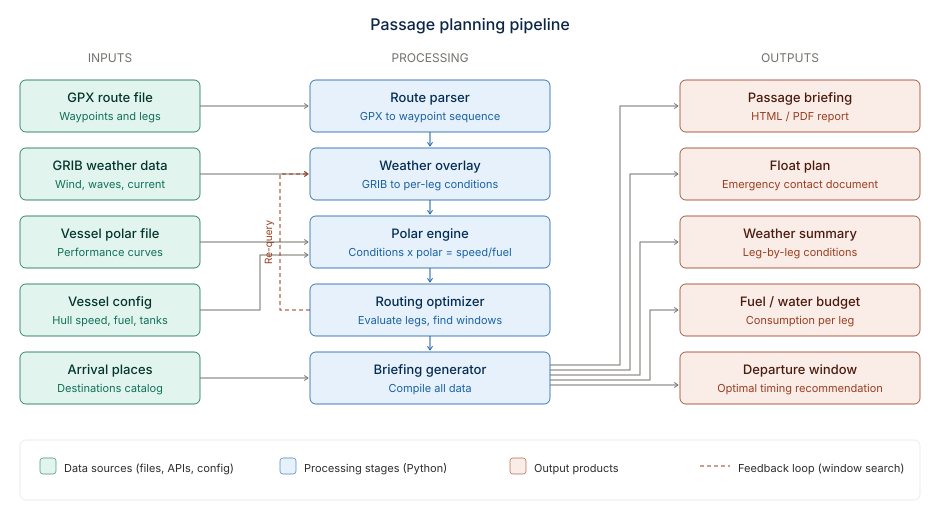

<!--
Purpose: How passage-planner is put together - processes, hosts, module map, how the CLI and the web
    app share one pipeline, frontend structure, deployment topology.
Version: v2 (2026-10-07) - rebuild-from-spec pass: module map completed (isochrone, sweep,
    marine_forecaster, boat_lookup, weather/field, research_jobs), backend routes moved to the endpoint
    table in Data-Flows-and-Interfaces.md, frontend panels completed, deployment topology updated
    (laptop is the interim host, Ship's PC at repair, Docker image built but not deployed), CI noted.
    v1 (2026-09-17..21, no header).
Scope: PRODUCTION - engineering wiki for passage-planner (
Architecture: passage-planner documentation. Linked from Home.md.
Invocation: n/a (reference doc)
-->

# Architecture

## Pipeline overview



## Process layout

One Python package (`passage_planner`, `src/`) that runs three ways: a CLI, a FastAPI backend
importing it in-process, and (through the backend) a React frontend. No message queue, no worker
process, no database server. The web backend is a thin form-to-pipeline wrapper plus a few small
form screens that edit config files.

```
  terminal ---> cli.py (argparse)  passage-planner brief | solve | sweep | export-polar | papers | ...
                     |
                     |  same Namespace shape
                     v
  browser ---> mx-inv :8000 /routing/** --reverse proxy--> backend/main.py (FastAPI, uvicorn,
                                                          127.0.0.1:8100, --reload)
                     |                                     |  serves frontend/dist (Vite build)
                     |  in-process import (no HTTP hop)    |
                     v                                     v
              service.run_brief()   <-- the ONE briefing pipeline both callers use
                     |
   config -> route -> passage -> polar -> analysis.refine() -> optional sections (compare, tropical,
   hydro, notices, advisories, papers, maintenance, comms, Parker) -> briefing -> export -> float plan
```

Ways to run the web form ([Operations](Operations.md) has the commands):

- **Production**: mx-inv's `run-live.bat` builds this project's `frontend/`, starts
  `backend/main.py` on `127.0.0.1:8100` in a separate minimized window with `--reload` (watching
  `backend/` and `src/`), then starts mx-inv on `0.0.0.0:8000` with `MXINV_ROUTING_URL` set so mx-inv
  mounts its `/routing/{path}` proxy. Users open `http://<host>:8000/routing`.
- **Dev**: `uvicorn backend.main:app --reload --port 8100` plus `npm run dev` in `frontend/` (Vite,
  port 5174, proxies `/api` to 8100 or to `VITE_API_TARGET`).
- **Container (built, not deployed)**: `Dockerfile` builds `frontend/dist` with Node 24, then runs
  `uvicorn backend.main:app --host 0.0.0.0 --port 8100 --proxy-headers` on python:3.13-slim-bookworm;
  `config/` and `var/` are bind-mounted, never baked in; healthcheck `GET /api/health`. Written to
  mx-inv's Docker deployment spec v5 (2026-09-24). CI builds it and starts it as UID 2300; nothing is
  pushed to a registry.

Because the production build is served under `/routing/`, `vite.config.ts` sets `base: '/routing/'`
for `build` only (dev stays `/`), and `App.tsx` builds API URLs from `import.meta.env.BASE_URL`
(`API_BASE`), never a hardcoded `/api/...`. A standalone build opened at `:8100/` therefore does not
resolve its assets; use the dev server for standalone work.

## `src/passage_planner/` module map

| Module | Role |
|---|---|
| `config.py` | TOML loader (`vessel.toml`, `sources.toml`) -> frozen dataclasses; secrets read from env by name; `HYLAS_INFLUX_URL` override. Pure apart from reading the files. |
| `errors.py` | One root `RoutingError`; per-subsystem branches (`ConfigError` incl. `MissingSecretError`, `RouteError`, `PolarError`, `InfluxError`, `OpsPanelError`, `PapersError`, `HydroError`, `WeatherError`, `FloatPlanError`, `CommsError`, `NoticeError`, `CoastalError`, `ActiveCaptainError` incl. `ActiveCaptainFetchError` / `ActiveCaptainDataError`, research errors). |
| `geo.py` | Spherical geodesy: haversine, bearing, destination point, TWA, point-of-sail label, along-course current component. |
| `route.py` | GPX -> `Route` (rte-then-trk, namespace-agnostic). |
| `passage.py` | Route + departure + speed -> timed fixes (`PassagePlan.sample_fixes`). |
| `polar.py` | `.pol` read/write, bilinear interpolation, best VMG, `polar_from_grid` (sparse cells). |
| `analysis.py` | Per-leg sail/motor/motorsail decision, SOG with current, fuel, flags; `refine()` convergence loop; fleet checks. |
| `clock.py` | Position-local time labels via `timezonefinder` (lazy import). |
| `fleet.py` | `config/fleet.json` library, per-passage fleet choice -> `VesselConfig.buddy_boats`. |
| `boat_lookup.py` | Parses pasted MarineTraffic / ORC text into spec fields and a polar. |
| `weather/openmeteo.py` | Route-corridor forecast (forecast + marine APIs) at future fix times. |
| `weather/compare.py` | GFS vs ECMWF divergence classification (`--compare`). |
| `weather/tropical.py` | NHC systems, dead-reckoned and screened against the corridor; outlook text. |
| `weather/field.py` | Corridor grid around the route, `Field.at(time, lat, lon)`, JSON cache under `var/cache/`. |
| `isochrone.py` | Corridor solver (per-leg DAG dynamic program over the grid), `to_gpx()`. EXPERIMENTAL. |
| `sweep.py` | Departure-window sweep using the fixed-route `analyze()`; Markdown table. EXPERIMENTAL. |
| `marine_forecaster.py` | Parses a pasted MWXC email; peak-wind comparison (section 3d). |
| `hydro/` | `bathy.py` (GEBCO triage), `enc.py` (NOAA ENC soundings), `tides.py` (CO-OPS + curve), `depths.py` (legacy `waypoint_depths.toml`), `soundings.py` (saved depths by position), `assess.py` (per-waypoint go/no-go + tide gate). |
| `notices.py` | NGA broadcast warnings, corridor-screened; USCG LNM pointer. |
| `consular.py` | State Department advisory + embassy per country, cached. |
| `ciq/` | Static CIQ dossier registry (7 countries) + renderer + unknown-country skeleton. |
| `papers/` | `scan.py` (filename classification), `overrides.py` (papers.toml read/write), `checklist.py` (trip-type matrix), `model.py` (DocKind, labels). |
| `comms.py` | Per-country comms registry, Starlink billing-cycle pacing, Calendar check; comms.toml read/write. |
| `coastal.py` | Point-to-coastline distance (shapely + bundled coastline) for the 12 NM comms heuristic. |
| `logistics.py` | Shore-logistics template, port splitting, coverage check. |
| `arrival.py` | Arrival-places schema, validator, loader, nearest lookup, merge CLI (`python -m passage_planner.arrival`). |
| `research.py` | Research with Claude: prompt, CLI discovery, child env, subprocess run, reply validation. |
| `research_jobs.py` | In-memory job registry: one job at a time, one port per subprocess, saves ok ports to `var/logistics/`. In `src/` so the test/mypy gate covers it. |
| `activecaptain/` | Garmin ActiveCaptain Community API client: tile download, SQLite cache, R-tree spatial query. `client.py` (API + cache), `query.py` (SQLite), `model.py` (dataclasses). See [ActiveCaptain Integration](ActiveCaptain-Integration.md). |
| `influx.py` | Read-only InfluxDB client (now pointed at a retired server - see Data Flows). |
| `ops.py` | Read-only sqlite pull of maintenance due from mx-inv's `vessel_local.db`. |
| `floatplan.py` | Fills the USPS Float Plan AcroForm (`pypdf`); crew roster loader. |
| `briefing.py` | Assembles sections 1-9 into Markdown; PENDING blocks for missing feeds. |
| `export.py` | Markdown -> HTML (markdown-it-py) and -> docx (python-docx). |
| `service.py` | `run_brief()`, `resolve_polar()`, `resolve_buddy_polars()`, `export_polar()`, path resolution. |
| `cli.py` | argparse entry point (`passage-planner` console script); forces UTF-8 stdout/stderr. |

Every module is independently testable and `mypy --strict` clean; `briefing.py` is the one place that
knows every other module's output shape.

## `service.py`: how CLI and web share one pipeline

`service.run_brief(args) -> BriefResult` is the whole pipeline: load config -> apply the fleet choice
-> parse GPX -> build `Clock` -> parse departure (bare time = local at WP1) -> `PassagePlan` ->
resolve the polar (and buddy polars) -> `analysis.refine()` -> optional sections, each in its own
`try/except` for that subsystem's error type -> `briefing.build_briefing()` ->
`export.write_briefing()` -> optional float-plan fill. It takes the `argparse.Namespace` the CLI's
`brief` subcommand parses; `backend/main.py`'s `_brief_args()` builds an equivalent `SimpleNamespace`
from form fields with every other attribute at the CLI default. `warn()` both appends to
`BriefResult.warnings` (returned to the web caller) and prints to stderr (CLI). Extracted from
`cli.py` on 2026-09-17 with byte-for-byte parity.

`solve`, `sweep` and `export-polar` are CLI-only and call `isochrone`, `sweep` and
`service.export_polar` directly; they do not go through `run_brief`.

## Backend (`backend/main.py`)

One file, `FastAPI(title="Hylas Routing — Passage Briefing")`, no CORS middleware, no auth. Endpoint
contracts: [Data Flows (7)](Data-Flows-and-Interfaces.md#7-the-web-apps-own-api-backend-8100-reached-as-routingapi-through-mx-inv).
Module-level state, all in memory and lost on restart: `_RUNS` (run id -> output paths) and
`_RESEARCH` (the research job registry). Uploads go to `var/web_uploads/` and are deleted in a
`finally`; outputs to `var/web_briefings/<run-id>/`, separate from the CLI's `var/briefings/` so a
web run never overwrites a CLI briefing (which mx-inv's cockpit reads). The form screens (fleet,
depth soundings, papers, comms) write their config files atomically through the library functions,
never directly.

## Frontend (`frontend/src/`)

| File | Role |
|---|---|
| `App.tsx` | The single page: route GPX, departure, speed, arrival & stops, travelling with, crew roster + guests, watch hours, float plan, collapsible Depth check / Documents / Comms plan / Advanced options / Shore logistics sections, submit guard, result view (stats, warnings, downloads, Markdown preview). Owns the logistics textarea and the merge rule (research never overwrites a hand edit; orphaned sections get a warning + Remove). |
| `ArrivalPicker.tsx` | Country-first pick list over the arrival places, search, "Other", route-end suggestions, per-stop role (check in / check out / fuel). |
| `FleetPanel.tsx` | "Travelling with": boat list editor + "Look up this boat" paste box. |
| `DepthCheckPanel.tsx` | Waypoints needing a chart depth; feet + source; Save / Forget. |
| `DocumentsPanel.tsx` | The 16 document kinds: path, issued, expires, note; one Save. |
| `CommsPanel.tsx` | Starlink / T-Mobile / Maya / router fields; one Save. |
| `ResearchPanel.tsx` | Research with Claude: availability, consent, progress, cancel, "Wrong place? Research as...". |
| `logisticsSections.ts` | Pure helpers: read / replace / remove one `### ` port section (checked by `node checks/logisticsSections.check.ts`). |
| `api/types.ts` | Hand-mirrored request/response types. |
| `main.tsx`, `App.css`, `index.css` | Bootstrap and plain CSS. |

Plain `useState`, no router, no state library. React 19.2, Vite 8, TypeScript ~6.0, `oxlint`. Dev port
5174 (mx-inv's dev server uses 5173).

## Repo shape and CI

Separate git repo (`shipboard-sa/passage-planner`, private, branch `main`) inside the `sailboat` tree at
` Python and the frontend share the repo with no monorepo tool. The web dependencies
are an optional extra (`pip install -e ".[web]"`), so a CLI-only install needs neither Node nor
FastAPI. GitHub Actions (`.github/workflows/ci.yml`) on push to `main` and on pull requests: job
`quality` (Python 3.13: `ruff check src tests`, `mypy src`, `pytest -q`) and job `image` (docker build,
run as UID 2300 with an empty `var/` mount, probe `/api/health`).

## Deployment topology (2026-10-07)

| Component | Where | Port |
|---|---|---|
| CLI | ` on the machine that runs mx-inv | terminal |
| Web backend | same machine, started by mx-inv's `run-live.bat` | `127.0.0.1:8100` (never in the firewall) |
| Web frontend (built) | served by the backend from `frontend/dist` | via 8100 |
| Public entry | mx-inv backend `/routing/{path}` reverse proxy | 8000 (LAN; tailnet) |
| Boat data (not read yet) | boat-automation, Ship's Automation | SignalK 3000, history 8090 |

The machine is **the owner's laptop (interim live host, 192.168.1.x)** while the Ship's PC is away for
repair; mx-inv and this backend move back to the Ship's PC when it returns. Routing must sit beside
mx-inv on disk (`../mx-inv/vessel_local.db`) for the maintenance read and beside `Papers of Record/`
two levels up for the papers check. Reachability is exactly mx-inv's.
